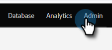
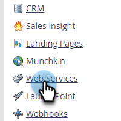
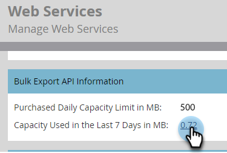
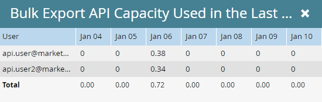

# Informazioni API dell’esportazione in blocco {#bulk-export-api-information}

Scopri come controllare la capacità di [estrazione in blocco delle API](https://experienceleague.adobe.com/en/docs/marketo-developer/marketo/rest/bulk-extract/bulk-extract){target="_blank"} utilizzata dall&#39;istanza di Marketo Engage negli ultimi sette giorni.

>[!NOTE]
>
>Se hai bisogno di ulteriore capacità, contatta il rappresentante del tuo account.

1. Nel Marketo personale, fare clic su **[!UICONTROL Admin]**.

   

1. Fai clic su **[!UICONTROL Web Services]**.

   

1. Scorri verso il basso fino alla scheda Informazioni API per esportazione in blocco. Fai clic sul numero accanto a &quot;Ultimi 7 giorni&quot; per visualizzare l’utilizzo per giorno/utente API.

   

   

>[!NOTE]
>
>L’allocazione per l’istanza Marketo Engage viene ripristinata ogni giorno alle 00:00 CST.
