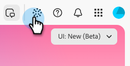

# Pannello CX Enterprise Coworker in Marketo Engage {#coworker-panel-overview}

Il pannello Collaboratore consente di aprire CX Enterprise Coworker direttamente da Marketo Engage, in modo da poter porre domande senza passare a un’interfaccia separata. È un’esperienza diversa da CX Enterprise Coworker per Marketo Engage. In versione beta, il pannello potrebbe continuare a cambiare.

>[!IMPORTANT]
>
>Questo articolo è solo per coloro che partecipano al pannello Closed beta di Coworker. Non divulgare.

## Cosa aspettarsi durante la versione beta {#what-to-expect-during-the-beta}

| Area | Dettagli |
| --- | --- |
| Accesso | Apri la versione beta incorporata da Marketo Engage. L&#39;esperienza CX Enterprise Coworker for Marketo Engage esistente rimane disponibile tramite il relativo [punto di accesso corrente](/help/marketo/product-docs/coworker-for-marketo/overview.md#access). |
| Conversazioni esistenti | La cronologia delle conversazioni esistente rimane disponibile nell’esperienza corrente di CX Enterprise Coworker for Marketo Engage. L’abilitazione della versione beta non rimuove tale cronologia. |
| Cronologia e contesto | La versione beta e l’esperienza esistente hanno una cronologia e un contesto separati per le conversazioni. Una conversazione in una non è disponibile nell&#39;altra. |
| Funzionalità esistente | Rimane disponibile nell’esperienza corrente. |
| Risposte e interfaccia | Risposte, controlli e layout possono differire tra le due esperienze. |

## Aprire e utilizzare il pannello Collaboratore {#open-and-use-the-coworker-panel}

1. In Marketo Engage, seleziona l&#39;icona **Collaboratore** nella navigazione superiore.

   

1. Immetti la richiesta. Includi i dettagli necessari al Collaboratore, ad esempio il nome di un programma o un intervallo di date; non presumere che sappia quale elemento stai visualizzando.

1. Rivedi la risposta. Fai domande di follow-up se hai bisogno di chiarirla o perfezionarla.

1. Per tornare all’area di lavoro di Marketo Engage, chiudi il pannello.

1. Rivedi le risposte generate ed eventuali modifiche proposte prima di utilizzarle.

## Esperienza CX Enterprise Coworker for Marketo Engage esistente {#existing-experience}

La cronologia e le funzionalità esistenti rimangono disponibili in Collaboratore per Marketo Engage. Non compaiono nella versione beta incorporata e l’accesso continuo all’esperienza corrente non significa che le due esperienze siano caratterizzate da parità di funzioni.

## Differenze tra le esperienze {#differences-between-the-experiences}

La versione beta incorporata e CX Enterprise Coworker per Marketo Engage sono esperienze separate. È possibile notare differenze anche quando si immette lo stesso prompt.

- **Risposte:** La formulazione, l&#39;organizzazione, il livello di dettaglio o la presentazione possono variare.
- **Interfaccia:** I layout, i controlli di chat e le modalità di revisione delle risposte possono essere diversi.

Se una funzionalità utilizzata oggi non è disponibile nella versione beta, continua a utilizzarla nell’esperienza corrente.

## Domande frequenti {#frequently-asked-questions}

**La versione beta sostituisce completamente CX Enterprise Coworker per Marketo Engage?**

No. Entrambe le esperienze sono disponibili in parallelo durante la versione beta.

**La cronologia delle conversazioni e il contesto sono condivisi tra le due esperienze?**

No. Il pannello Collaboratore in Marketo Engage e CX Enterprise Coworker per Marketo Engage dispone di cronologia e contesto separati per le conversazioni. Le conversazioni di una delle due esperienze non vengono visualizzate nell’altra. Per rivedere una conversazione esistente, apri l’esperienza da cui è stata avviata. Quando cambi esperienza, fornisci di nuovo lo sfondo e i dettagli necessari per la tua richiesta.

**Perderò le conversazioni o le funzionalità esistenti?**

No. L’abilitazione della versione beta non rimuove la cronologia delle conversazioni o la funzionalità esistente dall’esperienza corrente di CX Enterprise Coworker for Marketo Engage.

**Perché lo stesso prompt può produrre una risposta diversa?**

Le esperienze sono separate, quindi le loro risposte possono differire per quanto riguarda la formulazione, l’organizzazione, il livello di dettaglio o la presentazione. Prima di utilizzarla, esaminare la sostanza di una risposta.

**Cosa devo fare se non riesco a visualizzare la versione beta?**

Chiedi all’amministratore di Marketo Engage se l’abbonamento sta partecipando alla versione beta.

**Cosa succede se si verifica un problema con la versione beta?**

Puoi continuare a utilizzare l’esperienza corrente di CX Enterprise Coworker for Marketo Engage. Chiedi all’amministratore di Marketo Engage supporto o istruzioni per il feedback sulla versione beta.
